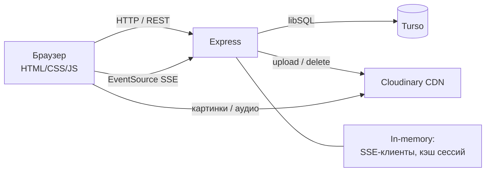

# Forum — real-time форум на Node.js + Turso + SSE

Полнофункциональный форум с чатом в реальном времени, личными сообщениями, уведомлениями, админ-панелью, кастомными темами и встроенным музыкальным плеером. Бэкенд — один Express-сервер, фронтенд — один `index.html` без сборки.

## Возможности

- **Форум**: темы, ответы, теги, закрепление, апвоуты, несколько изображений в посте
- **Real-time через SSE**: общий чат, личные сообщения, уведомления (без WebSocket-инфраструктуры)
- **Профили**: аватар, баннер, био, комментарии на стене, статус «онлайн»
- **Админка**: баны (по нику и email), иерархия префиксов/ролей с цветами, модерация
- **Кастомные темы** и фоновые изображения
- **Музыкальный плеер** на странице «О проекте» (глобальный трек из `site_settings`)
- **Безопасность**: bcrypt, CSRF-защита по Origin/Referer, CSP и security-заголовки, rate limiting (ранний флуд-лимитер, лимит на `/api`, отдельный лимит на логин/регистрацию)

## Архитектура



| Слой | Решение |
|---|---|
| HTTP-сервер | Express 4, раздаёт `public/` и SPA catch-all |
| БД | Turso (libSQL/SQLite), схема создаётся автоматически при старте (`CREATE TABLE IF NOT EXISTS` + мягкие миграции) |
| Сессии | `express-session` + собственный стор в Turso с in-memory кэшем (TTL 10 с), чтобы не делать сетевой запрос к БД на каждый хит |
| Real-time | SSE: `/api/chat/stream`, `/api/dm/stream`, `/api/notifications/stream`, heartbeat каждые 25 с, `X-Accel-Buffering: no` |
| Файлы | Cloudinary через `multer-storage-cloudinary` (папки `forum_avatars`, `forum_posts`, `forum_backgrounds`) |
| Защита | `express-rate-limit` v8, CSRF по Origin/Referer, CSP, `trust proxy` для работы за прокси Render |

> **Ограничение масштабирования.** Список SSE-клиентов и кэш сессий хранятся в памяти процесса, поэтому сервис рассчитан на **один инстанс**. Для горизонтального масштабирования понадобится брокер (например, Redis Pub/Sub) для рассылки событий.

## Структура

```
.
├── server.js            # Весь бэкенд
├── public/
│   └── index.html       # Весь фронтенд
├── Dockerfile
├── docker-compose.yml
├── render.yaml          # Blueprint для Render
├── .env.example
└── package.json
```

## Переменные окружения

| Переменная | Обязательна | Описание |
|---|---|---|
| `DATABASE_URL` | да | `libsql://<db>-<org>.turso.io` (для локальной разработки — `file:./local.db`) |
| `DATABASE_AUTH_TOKEN` | для Turso | Токен БД |
| `SESSION_SECRET` | в production | Не короче 32 символов: `openssl rand -hex 32` |
| `CLOUDINARY_CLOUD_NAME` / `CLOUDINARY_API_KEY` / `CLOUDINARY_API_SECRET` | да | Для загрузки изображений |
| `NODE_ENV` | нет | `production` включает Secure-cookie и `trust proxy` |
| `PORT` | нет | По умолчанию `3000` |
| `TRUST_PROXY` | нет | `true`/`false`, переопределяет автоопределение |
| `ALLOW_FIRST_USER_ADMIN` | нет | Только вне production: первый пользователь становится админом |

## Быстрый старт

### 1. Получите Turso-базу (без телефона)

```bash
# установка CLI: https://docs.turso.tech/cli/installation
turso auth signup            # через GitHub
turso db create forum
turso db show forum --url     # -> DATABASE_URL
turso db tokens create forum  # -> DATABASE_AUTH_TOKEN
```

### 2. Локально

```bash
cp .env.example .env     # заполните значения
npm install
npm run dev
```

Откройте http://localhost:3000. При `ALLOW_FIRST_USER_ADMIN=true` первый зарегистрированный пользователь станет админом.

### 3. Docker

```bash
cp .env.example .env
docker compose up --build
```

Compose запускает контейнер с `NODE_ENV=development`: по обычному http cookie с флагом `Secure` браузер не сохранит, и логин не заработает.

Образ для продакшена (`NODE_ENV=production` по умолчанию):

```bash
docker build -t forum .
docker run -p 3000:3000 --env-file .env -e NODE_ENV=production forum
```

### 4. Деплой на Render

1. Залейте репозиторий на GitHub.
2. Render → **New → Blueprint** → выберите репозиторий (подхватится `render.yaml`) или создайте Web Service вручную: Build `npm install --omit=dev`, Start `node server.js`, Health Check Path `/healthz`.
3. Заполните переменные окружения из таблицы выше. `SESSION_SECRET` Render сгенерирует сам.
4. После деплоя сделайте первого администратора (в production автоповышение отключено):

```bash
turso db shell forum
```
```sql
UPDATE users
SET isAdmin = 1, role_name = 'ADMIN', role_color = '#ff3333'
WHERE username = 'ваш_ник';
```

Бесплатный план Render усыпляет сервис после ~15 минут без трафика; встроенный keep-alive (`RENDER_EXTERNAL_URL` → `/healthz` раз в 10 минут) смягчает это.

## Схема БД

`users`, `sessions`, `banned_data`, `topics`, `replies`, `topic_upvotes`, `profile_comments`, `prefix_hierarchy`, `site_settings`, `chat_messages`, `private_messages`, `notifications`. Всё создаётся автоматически при первом запуске.

## Безопасность

- Пароли — bcrypt (cost 10)
- Cookie: `httpOnly`, `sameSite=lax`, `secure` в production
- Мутирующие запросы без совпадающего Origin/Referer отклоняются (403)
- Строгая CSP; внешние ресурсы разрешены только для Cloudinary и аудио по https
- Секреты хранятся только в переменных окружения, `.env` в `.gitignore`

## Лицензия

intelwebz corp
